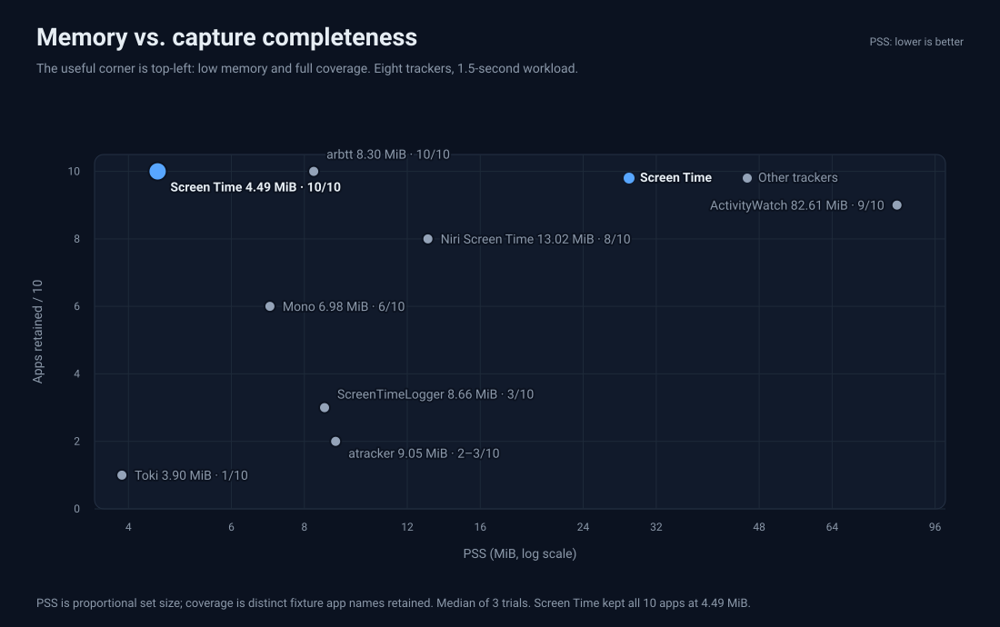

# screen-time-rofi

A local screen-time tracker for Hyprland and systemd. Open Rofi to see daily
totals, app timelines by category, and session details.

[](docs/EVALUATION.md)

Screen Time stays in the low-memory group while keeping all 10 fast-switch
apps. [See the charts and full comparison →](docs/EVALUATION.md)

## Quick start

On Linux with Hyprland, Rofi 2.x, and a systemd user session, download and run
the release installer as your desktop user:

```bash
curl -fsSLO https://github.com/WillGle/screen-time-rofi/releases/latest/download/install.sh
less install.sh
bash install.sh
~/.local/bin/rofi-screen-time
```

On NixOS or standalone Home Manager, import
`inputs.screen-time-rofi.homeManagerModules.default` and set
`services.screen-time.enable = true`. To preview an existing checkout:

```bash
nix build .#
./result/bin/rofi-screen-time
```

See the [user guide](docs/USER_GUIDE.md)
for distro dependencies, Nix and Home Manager examples, updates, and troubleshooting.
See the [evaluation](docs/EVALUATION.md)
for charts, sandbox benchmarks, and a comparison with ten Linux trackers.

## Use

- `←` / `→` browse days, `T` returns to today, and `R` refreshes.
- `↑` / `↓` selects an app, `Enter` opens its details, and `Backspace` returns.
  `Esc` closes the popup.
- `Alt+1` through `Alt+3` select and remember Nord, Solarized Light, or Gruvbox Dark.
  `Alt+4` clears the saved choice and restores the configured theme.

To set a default theme, edit `~/.config/screen-time/config.toml` and reopen Rofi:

```toml
[theme]
mode = "nord" # auto | matugen | static | config | nord | solarized | gruvbox
```

[Developer docs](docs/README.md) · [MIT license](LICENSE)
