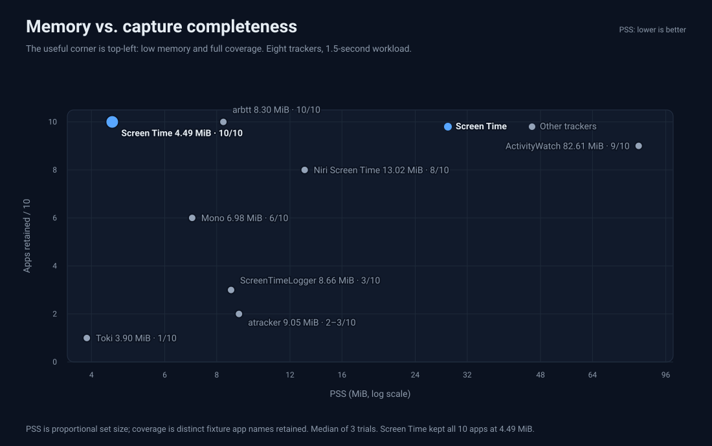
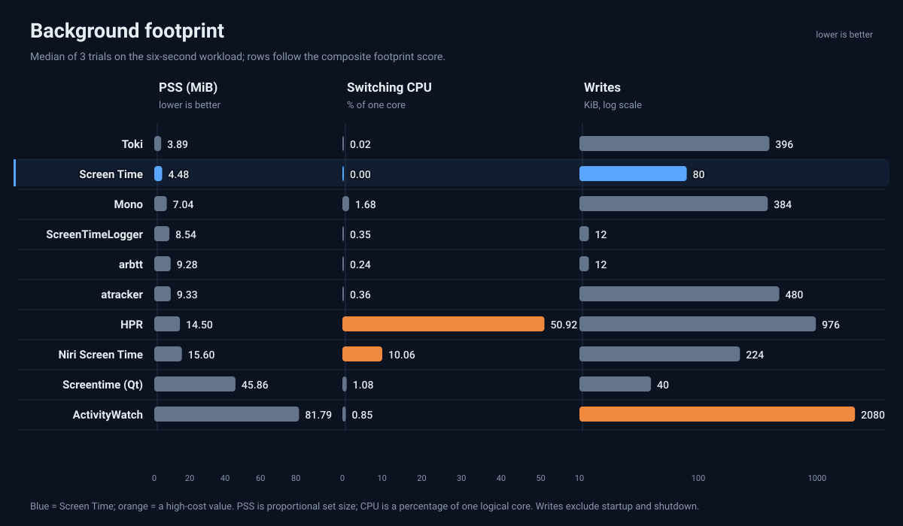
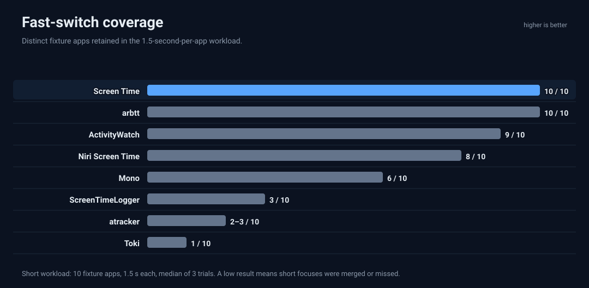
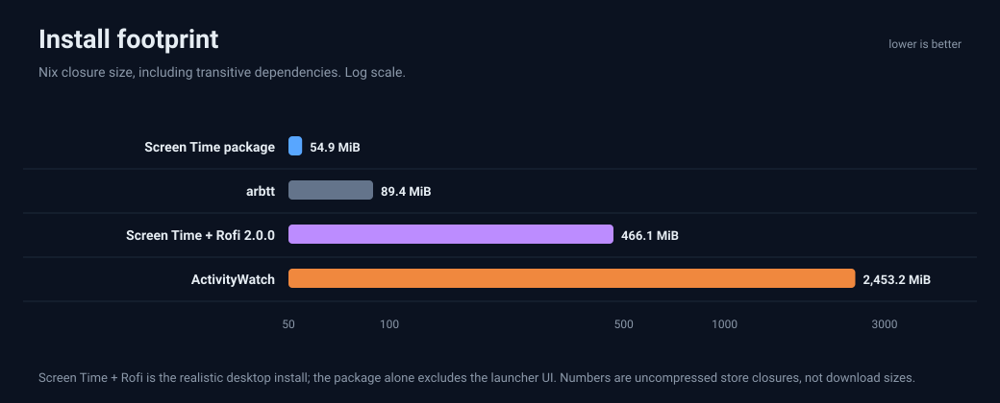

# Screen Time vs Linux trackers

This page compares Screen Time 0.2.1 with nine Linux trackers in the same
sandbox. It focuses on background cost, fast-switch coverage, UI latency, and
installation footprint. The 0.3.0 release did not change these paths. For
installation and configuration, see the [user guide](USER_GUIDE.md).

The comparison is intentionally narrow. Screen Time is a Hyprland-only,
app-level, local-only tracker with a keyboard-first Rofi popup. Several
competitors cover more platforms, richer reports, or cloud workflows. Read the
tradeoffs, not just the lowest number.

## At a glance



- **Best measured balance:** Screen Time uses 4.49 MiB PSS and retained all
  10 fixture apps in the 1.5-second workload. It is the only tracker under
  5 MiB that kept 10/10.
- **Lightest raw process:** Toki uses 3.90 MiB, but retained only 1/10 short
  switches. Its five-second noise floor merges brief focuses into the previous
  session.
- **Heaviest background stacks:** ActivityWatch uses 81.79 MiB and writes
  2,080 KiB in the six-second run. HPR uses 50.92% of one core; Niri Screen Time
  uses 10.06%.
- **Not a feature-parity contest:** ActivityWatch, HPR, atracker, and ManicTime
  cover broader reporting. Screen Time competes on speed, focus, and local
  app-level data.

The scatter uses the 1.5-second workload, so it includes the eight trackers that
were measured there. The leaderboard below uses the six-second cohort; HPR and
Screentime appear only in that cohort.

### Footprint leaderboard

| # | Tracker | PSS (MiB) | Processes / threads | CPU, switching | Writes (KiB) | Score |
|---:|---|---:|---:|---:|---:|---:|
| 1 | Toki | 3.89 | 1 / 8 | 0.02% | 396 | 100.0 |
| 2 | **Screen Time** | **4.48** | **1 / 3** | **0.00%** | **80** | **90.2** |
| 3 | Mono | 7.04 | 1 / 6 | 1.68% | 384 | 66.5 |
| 4 | ScreenTimeLogger | 8.54 | 1 / 1 | 0.35% | 12 | 59.2 |
| 5 | arbtt | 9.28 | 1 / 2 | 0.24% | 12 | 56.5 |
| 6 | atracker | 9.33 | 1 / 22 | 0.36% | 480 | 56.3 |
| 7 | HPR | 14.50 | 1 / 6 | 50.92% | 976 | 45.1 |
| 8 | Niri Screen Time | 15.60 | 1 / 9 | 10.06% | 224 | 43.7 |
| 9 | Screentime (Qt) | 45.86 | 1 / 3 | 1.08% | 40 | 31.4 |
| 10 | ActivityWatch | 81.79 | 4 / 25 | 0.85% | 2,080 | 9.8 |

Score weights PSS 75% and process count 25%; higher is lighter. It is a
footprint score, not a capture-quality score. The fast-switch chart below is the
quality check.

## Background footprint



Screen Time lands at 4.48 MiB PSS, 0.00% switching CPU, and 80 KiB of writes.
Against ActivityWatch, that is roughly **1/18 the PSS** and **1/26 the writes**
in this workload. Toki is smaller at 3.89 MiB, but it writes 396 KiB and loses
short-switch coverage. HPR and Niri are the CPU outliers; ActivityWatch is the
memory and write outlier.

Steady-focus CPU was near zero for most trackers. HPR reported 54.10%, Niri
10.70%, Mono 1.90%, and Screentime 1.20%; the rest were at or below 0.50%. CPU
includes child processes reaped by the tracker group during the phase.

## Fast switching



The short workload switches once every 1.5 seconds and checks how many distinct
fixture apps survive in each tracker's own records.

- **10/10:** Screen Time, arbtt (arbtt was forced to one sample per second; its
  default is 60 seconds).
- **9/10:** ActivityWatch.
- **8/10:** Niri Screen Time.
- **6/10:** Mono.
- **3/10:** ScreenTimeLogger.
- **2–3/10:** atracker.
- **1/10:** Toki. Its default five-second noise floor absorbs shorter focuses
  into the previous session; the number describes what its SQLite history
  retained.

[Toki session policy at the tested revision](https://github.com/Ciatel-Arlanta/Toki/blob/5ae5e3b075309da9c3fa144329d37af880c31f83/crates/toki-core/src/tracker.rs)

Screen Time's 0 KiB write figure in the 15-second window excludes its shutdown
flush. All scripted focus changes were verified in SQLite after termination.

## UI latency and memory

The packaged app read SQLite history generated by the six-second workload.

| Metric | Median | Range | Runs |
|---|---:|---:|---:|
| Rust renderer, warm | 6.02 ms | 3.55–9.57 ms | 11 |
| Launcher to visible Rofi window | 87.6 ms | 80.7–210.6 ms | 10 |
| Launcher + Rofi PSS | 5.99 MiB | 5.87–6.03 MiB | 10 |

The renderer is not the bottleneck; Rofi, theme generation, and font startup
dominate. An earlier wrapper/theme run measured 163.3 ms to visible, and a
real-desktop run with the user theme/font measured roughly 185–260 ms. Those
runs used different wrapper logic and are not directly comparable.

This suite did not measure the browser, Qt, Tauri, or terminal interfaces of the
other trackers under an equivalent foreground workload.

## Features and fit

Screen Time is not the most feature-rich option. It is the smallest measured
stack that combines Hyprland event capture, app-only storage, a keyboard-first
popup, and a per-user installer/Nix module.

| If you need | Strong fit | Why |
|---|---|---|
| Fast daily check on Hyprland | Screen Time | Event-driven app capture, Rofi popup, no titles |
| Broad local reporting | ActivityWatch, HPR | Categories, extensions, projects, goals, insights |
| Browser dashboard | atracker | React dashboard and HTTP API |
| Terminal or scripted reports | Mono, arbtt, Niri Screen Time, ScreenTimeLogger | CLI/ASCII or text/JSON output |
| Cloud or team reporting | ManicTime | Cloud/Server timelines and shared reports |
| Closest Hyprland-native peer | Toki | Hyprland collector with desktop UI and browser context |

<details>
<summary><strong>Full feature comparison</strong></summary>

| App | Linux capture and setup | History and dependencies | UI and reporting | Strengths and trade-offs |
|---|---|---|---|---|
| **Screen Time** | Hyprland IPC events, systemd user service, Rofi 2.x. Per-user release installer or Nix/Home Manager. | Local SQLite WAL and tmpfs snapshot. App class only. Idle detection uses logind. | Rofi day timeline with 30-minute slots, app details, 7-day history, category labels, Matugen and preset shortcuts. | Fast keyboard access, no window titles, low daemon footprint. Hyprland-specific, fixed categories, no built-in web or project reports or browser URL tracking. The main timeline fills a half-hour slot after at least one minute of app use in that slot. |
| [ActivityWatch](https://docs.activitywatch.net/en/latest/watchers.html) | Official window watcher on X11. Wayland capture uses community watchers. Native Linux package or release archive. | Local server and watchers. Browser/editor extensions are optional. Window watcher records app and title; AFK has its own watcher. | Browser timeline, category rules, cross-platform reporting and extensible watchers. | Mature local reporting with rules and extensions. A browser and several background processes are involved. |
| [arbtt](https://arbtt.nomeata.de/doc/users_guide/effective-use.html) | X11 sampling daemon and CLI. Package availability varies; Nix provides `haskellPackages.arbtt`. | Local binary capture log. Samples capture window metadata and inactivity. Default interval is 60 seconds. | CLI statistics and rule-based categorization. | Small writes in the sandbox. Setup and reporting require text rules; polling can miss brief activity. |
| [ManicTime for Linux](https://docs.manictime.com/linux/installation) | Linux client packages include DEB, RPM and tarball. [Wayland support depends on compositor](https://docs.manictime.com/linux/wayland), including Hyprland app tracking. | Linux tracker sends data to ManicTime Cloud or a connected Server. Screen lock/away detection; URL and screenshot support depends on extensions and desktop support. | [Cloud or Server timeline and reports](https://docs.manictime.com/server/reports/overview), tagging, shared reporting. | Useful for detailed work records and team reporting. The Linux tray client needs the connected service to view timelines. |
| [HPR](https://github.com/plexescor/HPR) | Compiled Linux release. Hyprland, niri, KDE, GNOME and Cinnamon backends with desktop-specific setup. | Local SQLite. App, title and optional extension data. Configurable network access and tray integration. | Slint desktop UI, goals, limits, projects, insights and switch history. | Broad Wayland coverage and richer analysis. Linux release dependencies and integrations vary by desktop; extensions can add collection and runtime costs. |
| [Mono](https://github.com/xonoxc/mono) | Linux Rust build with user daemon. Hyprland, Sway, GNOME, KDE and X11 backends with differing capabilities. | Local SQLite. App and window titles, configurable category and browser tracking features. | Ratatui terminal dashboard and CLI for summaries. | Keyboard-oriented without a browser; broader compositor support. Terminal interaction and title collection differ from the app-only popup. |
| [Niri Screen Time](https://github.com/probeldev/niri-screen-time) | Go binary, AUR or source. niri and Hyprland. The measured upstream revision invokes `/bin/zsh` for compositor commands. | Local SQLite. Records app identity and title. | CLI for aggregate and detailed date-range reports, with text and JSON output. | Scriptable and supports niri. The reader uses a CLI rather than a dedicated popup. |
| [atracker](https://github.com/nichsedge/atracker) | Rust watcher and React dashboard. Hyprland and niri IPC plus other desktop-specific integrations. | Local SQLite and HTTP API; app/window details. Optional connectivity and multi-device features have their own setup. | Browser dashboard, configurable categories, filters, timeline and productivity views. | Flexible dashboard and native Wayland backends. Foreground use needs a browser, and API bind address matters when deploying. |
| [Toki](https://github.com/Ciatel-Arlanta/Toki) | Linux Hyprland collector with Debian, RPM and tarball releases. Rust daemon and on-demand Tauri/WebKitGTK UI. | Private SQLite; app sessions and local browser-domain resolution. Native idle and audio features depend on Wayland/logind/audio services. | Desktop timeline and category/usage breakdowns. | Direct Hyprland peer with richer presence and browser context. Those features and the WebKit UI need separate runtime tests. |
| [ScreenTimeLogger](https://github.com/abhinavbxr/ScreenTimeLogger) | Hyprland and Python standard library. User systemd service runs a `hyprctl` poll every 5 seconds by default. | Local append-only monthly JSONL with app, title, time range and duration. | CLI text or JSON reports, hourly heatmaps and session export. | Readable files and few dependencies. Five-second polling can miss brief switches; reporting stays in the CLI. |
| [Screentime by truelockmc](https://github.com/truelockmc/Screentime) | Python/Qt desktop app, X11, optional KDE Wayland KWin bridge. Other Wayland sessions can appear as one generic entry. | Local SQLite daily totals; app identification depends on desktop integration. | Desktop and tray window, app totals, charts and date-range statistics. | Convenient GUI for Linux users with a supported backend. Native per-app capture on Hyprland is absent from its documented setup. |

</details>

## Installation footprint



The Screen Time package alone is 54.9 MiB in the Nix closure. A realistic
desktop install adds Rofi: **466.1 MiB**. That is still well below the measured
ActivityWatch closure at **2,453.2 MiB** without a separate browser, but above
arbtt at **89.4 MiB**. These are uncompressed store closures, not download
sizes or incremental disk use on a host that already has shared dependencies.

## Method

<details>
<summary><strong>Setup, metrics, and caveats</strong></summary>

### Setup

The suite uses ten distinct synthetic app identities on Xvfb at 1920×1080.
Trackers with X11 capture read window properties. Native Hyprland trackers
receive equivalent active-window changes through the fake Hyprland command and
event sockets. Each synthetic app has a distinct PID and executable path for
trackers that resolve the focused process.

The host was NixOS on an AMD Ryzen 7 8845H. Bubblewrap isolated the PID,
network, X11 socket, home, and runtime paths. Filesystem writes went to
temporary ext4 state directories. All inputs were synthetic, and no account,
personal browser history, or real desktop socket was used.

The main comparison uses a 10-second unchanged-focus period and 10 changes on a
six-second cadence, with 66 seconds in the switching phase. The short workload
uses one pass across ten apps at 1.5 seconds each. Each tracker result is a
median across three trials. The input schedule is the same within each cohort.

ActivityWatch ran its supervisor, server, window watcher and AFK watcher,
without a browser. arbtt ran at one sample per second versus its 60-second
default so the short workload could exercise sampling. Screen Time's logind
watcher was disabled in the fixture. atracker bound its API to loopback on an
ephemeral port. The other configured capture intervals were their upstream
defaults.

HPR used its true-headless mode with network access and app termination
disabled. Screentime ran its Qt desktop process with the window hidden. These
preserve each product's documented background mode.

### Metrics

PSS and process/thread counts are end-of-phase snapshots for the tracker process
group. CPU is a percentage of one logical core and includes CPU time from
children reaped by that group during the phase. Reported kernel writes exclude
startup and shutdown. `Apps seen` counts distinct fixture app names observed in
each tracker's native records. It cannot establish duration accuracy or count
every transition for a sampling tracker.

The footprint score weights PSS 75% and process count 25%. Each component is
`100 × lowest median / observed median`; the lowest value is recomputed inside
each cohort. The score describes one workload's measured background footprint,
not feature quality or capture accuracy. CPU, writes, and coverage have their
own columns.

### Tested builds

| Tracker | Version or source used |
|---|---|
| Screen Time | 0.2.1 with the redesigned app-detail UI, exact binary hash in the raw data |
| ActivityWatch | 0.13.2 packaged by Nixpkgs |
| arbtt | 0.12.0.3 packaged as `haskellPackages.arbtt` |
| ScreenTimeLogger | 1.0.0, [source 15f04aa](https://github.com/abhinavbxr/ScreenTimeLogger/tree/15f04aab4b91e4f7b77482915ea57b3dcb310534) |
| Niri Screen Time | [source 147fdc3](https://github.com/probeldev/niri-screen-time/tree/147fdc3837b79dfadb54d31a236ede6a6e4fba1a), built with `CGO_ENABLED=0 go build -trimpath` |
| Mono | Cargo 0.3.0, [source 8c0d088](https://github.com/xonoxc/mono/tree/8c0d08866cb1080fa64a2a374d9deb284606f040), `cargo build --release --locked --bin mono-tracker` |
| Toki | 0.5.1, [source 5ae5e3b](https://github.com/Ciatel-Arlanta/Toki/tree/5ae5e3b075309da9c3fa144329d37af880c31f83), `cargo build --release --locked -p toki-daemon` |
| HPR | [Linux release 0.9.13](https://github.com/plexescor/HPR/releases/tag/v0.9.13), executable and bundled Slint library |
| Screentime Qt | [source ebc0fe2](https://github.com/truelockmc/Screentime/tree/ebc0fe2ca138ce146a7aa119abadd69a7cffcf58), Python 3.13 and PyQt5 5.15.10 |
| atracker | [source 5f22da9](https://github.com/nichsedge/atracker/tree/5f22da966868a2a208cf43cd39271856301ac64a), `cargo build --release --locked` inside `atracker-rs` |

### Wrappers and limits

- HPR's wrapper copies the bundled `config.csv` into the sandbox's
  `$HOME/.config/HPR/`, sets `true-headless-mode,true`,
  `allow-network-activity,false` and `kill-apps,false`, then launches the
  bundled executable. On the tested NixOS host it used a glibc 2.44 loader and
  supplied the bundled Slint, D-Bus, libcurl, GCC runtime and font libraries.
  `libslint_cpp.so` requires a glibc symbol version of at least 2.43.
- Screentime's wrapper copies its Python files and `map.json` into writable
  sandbox state before launching `main.py`. The app's database is located beside
  its source files. Use Python with PyQt5, psutil, qdarkstyle and Pillow, and set
  `QT_PLUGIN_PATH` to the Qt5 plugin directory containing the XCB platform
  plugin. The runner supplies `--hidden`.
- ActivityWatch's summed PSS/RSS overcounts shared pages because it is
  multi-process. Treat its memory number as directional.
- The suite does not compare actual idle, lock, sleep, audio activity, browser
  URLs, or mobile tracking. It also does not measure ManicTime resources, and
  HPR/Screentime results depend on their wrappers.
- Xvfb uses software rendering. Absolute latency and memory differ on real
  hardware; the relative ordering is the useful result.

</details>

## Reproduction

<details>
<summary><strong>Benchmark and chart commands</strong></summary>

Build the package, provide Xvfb and Rofi 2.x on `PATH`, then run the launcher
from the repository root. The launcher expects a NixOS host with Bubblewrap,
Nix, Rofi 2.x, Xvfb and `hyprctl`. Put ActivityWatch, arbtt, zsh, xdotool and
Python with Xlib on `PATH`. The input directory is mounted read-only except for
its `results/` directory.

```bash
nix build .#

inputs=/tmp/screen-time-competitors
bash scripts/benchmark-linux-sandbox.sh "$inputs" \
  --apps 10 --repeats 3 --switches 10 --interval 6 \
  --arbtt "$(command -v arbtt-capture)" \
  --logger "$inputs/ScreenTimeLogger/screentime_logger.py" \
  --niri "$inputs/niri-bin" \
  --mono "$inputs/mono/target/release/mono-tracker" \
  --toki "$inputs/Toki/target/release/toki-daemon" \
  --atracker "$inputs/atracker/atracker-rs/target/release/atracker-rs" \
  --output "$inputs/results/linux-expanded-steady.json"
```

For the short workload, use `--switches 9 --interval 1.5 --skip-ui` and a
separate output. For the ten-tracker run, add `--skip-ui --hpr
"$inputs/hpr-wrapper" --screentime "$inputs/screentime-wrapper"` and a separate
output. Both wrappers must launch the upstream app without installing or
enabling it on the host.

The charts are generated from the raw JSON:

```bash
python3 scripts/render-evaluation-charts.py
python3 scripts/render-evaluation-charts.py --check
```

</details>

Raw data: [ten-tracker run](benchmarks/linux-ten-trackers.json),
[eight-tracker run](benchmarks/linux-expanded-steady.json),
[1.5-second workload](benchmarks/linux-expanded-short.json), and
[original three-tracker run](benchmarks/linux-trackers.json).

Earlier three-tracker results used different display geometry, wrapper logic,
and timing conditions. The JSON is linked above; UI-shell and M9 measurements
are retained in the local internal report. They are not directly comparable to
the current charts.

## Limitations

- The fixture is synthetic. It is not a full desktop day and cannot prove
  duration accuracy for every tracker.
- Active time is not screen-on time. Lock, suspend, and display-off are outside
  this comparison.
- PSS overcounts shared pages for multi-process trackers. The footprint score
  weights memory and process count; it is not a universal ranking.
- Absolute latency and memory depend on Xvfb, fonts, and host conditions.
- ManicTime has no resource result here, and HPR/Screentime use product-specific
  wrappers. AArch64 was not measured in this cohort.
